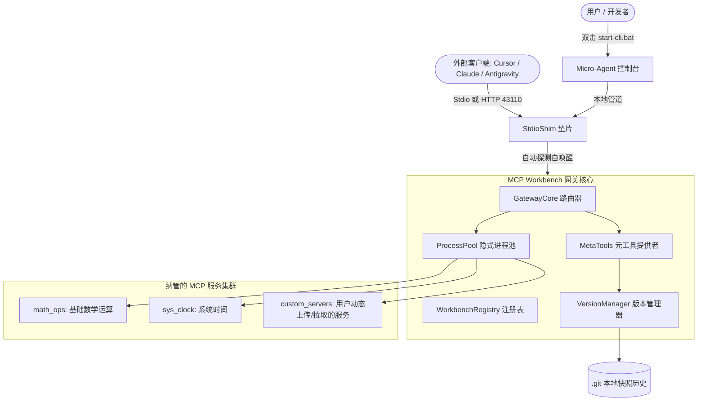

# MCP Workbench 架构设计与分类全景说明

本文档详细描述 `mcp-workbench-prototype-v0.0.3` 项目的体系结构、模块职责划分与数据流转机制。

---

## 1. 核心设计理念

- **单入口聚合（Single-Entrypoint Aggregation）**：消除外部 AI 客户端（Cursor、Claude、Antigravity）分别配置数十个微服务与端口的复杂性，对外统一暴露标准的 HTTP (`127.0.0.1:43110/mcp`) 与 Stdio (`dist/stdio_shim.js`) 双协议通道。
- **四驱动模型（4 Server Driver Types）**：支持传统子进程（`stdio_process`）、零子进程 OpenAPI/REST API 虚拟映射（`virtual_openapi`）、宿主软件主线程反向 IPC 网桥（`software_bridge`）以及 Agent 现场自合成自测沙箱（`builder_sandbox`）。
- **零信任策略与带外审批（PolicyGuard & Out-of-Band Admin）**：高危操作（文件修改、删除等）通过独立的带外管理端点（`/admin/approve`）配合人类审批密钥放行，防范 Agent 自审批越权。
- **精细化角色/工作区隔离（ContextProfileRouter）**：根据客户端进程名（PPID反查）与工作区 CWD 实现全链路（列表 + 搜索 + 穿透调用）工具严格隔离。
- **全隐式守护（Zero Window Popups）**：通过底层注入 Windows `CREATE_NO_WINDOW (0x08000000)`，消除任何后台黑框弹窗。
- **自主回退与防改坏保障（Atomic Snapshot & Rollback）**：工作区内置原子快照机制，随时可一键备份、比对代码差异与安全回滚。

---

## 2. 工作区目录分类与结构

```text
mcp-workbench/
├── .git/                     # 本地 Git 版本历史与快照标签存储
├── .gitignore                # 运行时锁文件、日志与备份排除配置
├── docs/                     # 项目设计文档与规范说明
│   ├── SPECIFICATION_v0.0.3.md # 初始协议与详细设计规格书
│   ├── ARCHITECTURE.md       # 本文档（系统架构与设计说明）
│   └── VERSION_CONTROL.md    # 项目版本管理、快照与回滚操作指南
├── src/                      # 网关核心 TypeScript 源码
│   ├── types.ts              # 核心协议类型定义 (JSON-RPC, 4类驱动类型, MCP)
│   ├── registry.ts           # 服务状态、工具缓存与运行时注册表
│   ├── process_pool.ts       # 轻量级隐式进程池与生命周期管理
│   ├── aggregator.ts         # 统一多驱动工具聚合器与调度中心
│   ├── meta_tools.ts         # 网关内置 19 个全局元工具 (服务增删、冷工具搜索、版本快照、策略配置)
│   ├── version_manager.ts    # Git 驱动的原子快照与安全回滚管理器
│   ├── client_binder.ts      # 5层漏斗外部客户端智能探测与安全合并
│   ├── gateway_core.ts       # JSON-RPC 请求调度与会话路由器
│   ├── daemon.ts             # 单例核心守护进程 (mcp-workbenchd)
│   ├── stdio_shim.ts         # 零触感自唤醒 Stdio-to-Daemon 垫片
│   ├── openapi_connector.ts  # [Module 1] OpenAPI 3.x 零子进程虚拟连接器
│   ├── profile_router.ts     # [Module 2] Context Profile 角色与工作区全链路隔离路由
│   ├── policy_guard.ts       # [Module 3] PolicyGuard 安全策略、两阶段围栏与带外审批
│   ├── software_bridge.ts    # [Module 4] 桌面宿主软件反向 IPC 网桥 (Revit/Blender)
│   ├── builder_sandbox.ts    # [Module 5] Agent 工具代码合成与隔离沙箱自测引擎
│   └── verify_acceptance.ts  # 14 大网关全链路端到端自动化验收测试用例
├── dist/                     # 编译生成 / 运行时 JavaScript 脚本
│   ├── test_servers/         # 模拟测试用 MCP 服务 (mock_server_a/b/c)
│   └── (与 src 对应的 .js 运行时模块)
├── micro_agent/              # 纯本地微智能体与交互式控制台
│   ├── core/                 # 底层通信与基础配置
│   │   ├── mcp_client.mjs    # JSON-RPC 2.0 异步双工通信客户端
│   │   └── config.mjs        # ANSI 终端色彩与品牌横幅
│   ├── cli/                  # 控制台命令行交互层
│   │   ├── wizard.mjs        # 交互式参数补全向导
│   │   ├── repl.mjs          # 交互式 REPL 会话引擎
│   │   ├── runner.mjs        # CLI 命令调度路由器
│   │   └── commands/         # 命令功能插件集合
│   │       ├── cmd_status.mjs  # 网关状态与服务查询
│   │       ├── cmd_tools.mjs   # 工具清单与搜索
│   │       ├── cmd_call.mjs    # 工具调用向导
│   │       ├── cmd_servers.mjs # 动态服务增删重载
│   │       ├── cmd_clients.mjs # 客户端 5 层漏斗探测与绑定
│   │       ├── cmd_version.mjs # 历史版本、快照与回退指令
│   │       └── cmd_test.mjs    # 微智能体自动化回归测试
│   ├── cli_frontend.mjs      # 控制台启动门面
│   ├── mini_agent.mjs        # 自主推理状态机引擎
│   └── test_agent.mjs        # 微智能体 6 大场景自动化验收脚本
├── scripts/                  # 辅助工具脚本
│   ├── start-daemon.ps1      # 单独启动后台守护进程脚本
│   └── verify-v0.0.1.ps1     # 验收快捷脚本
├── workbench.json            # 网关核心配置与纳管服务清单
├── start-cli.bat             # Windows 一键交互控制台启动器
├── package.json              # 项目元数据与 scripts 定义
└── README.md                 # 项目首页综合导航说明
```

---

## 3. 数据流与交互链路


